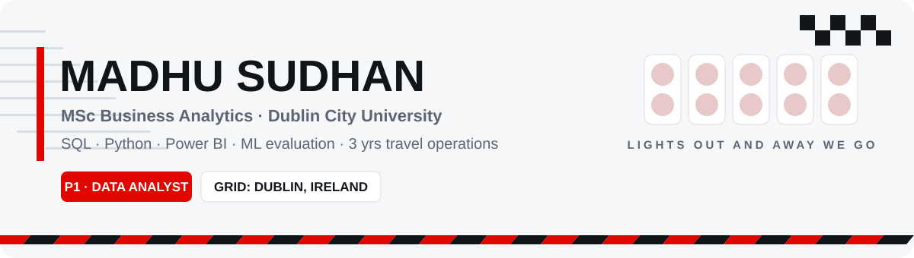

  <picture>
    <source media="(prefers-color-scheme: dark)" srcset="dark.svg">
    <source media="(prefers-color-scheme: light)" srcset="light.svg">
    
  </picture>

  

  
  
  

I'm Madhu. I build data and AI-backed web apps, and I like being able to show that the numbers are right.

## Now

- MSc in Business Analytics at Dublin City University (DCU), Dublin
- Looking for data and analytics roles in Ireland
- Portfolio: [smadhu6364-beep.github.io](https://smadhu6364-beep.github.io)

## Selected work

<table>
<tr>
<td width="50%" valign="top">

### [LLM Risk Register Benchmark](https://github.com/smadhu6364-beep/public-reproducible-benchmark)
Three LLMs and three prompting strategies compared on generating risk registers from 21 real project planning documents (World Bank and UK government). Full pipeline and 456 unit tests; the paper is targeting an IEEE conference.

  

</td>
<td width="50%" valign="top">

### [CivicPulse](https://github.com/smadhu6364-beep/civicpulse)
Upload a photo of a local problem and Gemini Vision categorises it, rates severity, works out which authority is responsible and drafts the complaint. Reports go on a live map where neighbours can verify and upvote them.

    

</td>
</tr>
<tr>
<td width="50%" valign="top">

### [Foodiepy](https://github.com/smadhu6364-beep/foodiepy)
Django app built with three other contributors. A gradient boosting model forecasts order volume for fulfilment centres, alongside inventory, customer and order management for restaurant owners.

  

</td>
<td width="50%" valign="top">

### [Roam](https://github.com/smadhu6364-beep/roam-travel)
Trip-planning and booking front end: destinations, itinerary builder, cost calculator and booking flow. Flight search and payments are scaffolded, not yet connected to a backend.

   

</td>
</tr>
<tr>
<td colspan="2" valign="top">

### [In-browser computer vision demos](https://github.com/smadhu6364-beep/aiml-project)
Undergraduate project: body segmentation, face mesh, hand pose and object detection running live in the browser.  

</td>
</tr>
</table>

## Tools

  

## On GitHub

  
  

  <picture>
    <source media="(prefers-color-scheme: dark)" srcset="https://raw.githubusercontent.com/smadhu6364-beep/smadhu6364-beep/output/snake-dark.svg" />
    <source media="(prefers-color-scheme: light)" srcset="https://raw.githubusercontent.com/smadhu6364-beep/smadhu6364-beep/output/snake.svg" />
    
  </picture>

## Recent activity

<!--START_SECTION:activity-->
- 🔨 Updated [`smadhu6364-beep/hotel_website`](https://github.com/smadhu6364-beep/hotel_website)
- 🌱 Created branch `master` in [`smadhu6364-beep/technical-seminar`](https://github.com/smadhu6364-beep/technical-seminar)
- 🔨 Updated [`smadhu6364-beep/food-website`](https://github.com/smadhu6364-beep/food-website)
- 🔨 Updated [`smadhu6364-beep/technical-seminar`](https://github.com/smadhu6364-beep/technical-seminar)
- 🔨 Updated [`smadhu6364-beep/Chat_Bot`](https://github.com/smadhu6364-beep/Chat_Bot)

_Last updated 2026-10-18 02:00 UTC_
<!--END_SECTION:activity-->

## Contact

Email: [smadhu6364@gmail.com](mailto:smadhu6364@gmail.com)
